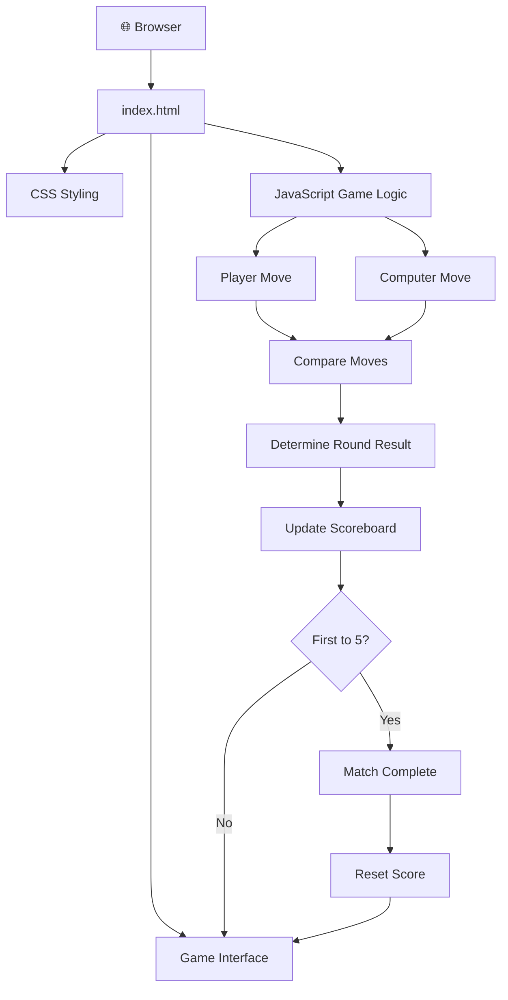

# ✊ Hand-Club

<p align="center">
  
  
  
  
</p>

<h3 align="center">✋ Three Hands. One Showdown. Endless Rematches.</h3>

<p align="center">
  A modern, interactive Stone, Paper, Scissors game where you challenge the computer, win rounds, and race to five victories.
</p>

<p align="center">
  <a href="https://aditya2025-code.github.io/Hand-Club/">
    
  </a>
  <a href="https://github.com/aditya2025-code/Hand-Club">
    
  </a>
</p>

---

## 🎮 The Game

**Hand-Club** brings the classic Stone, Paper, Scissors game to the browser with an interactive, game-focused interface.

Choose your move, face the computer's choice, and try to become the first player to score five wins. Every round is a fresh opportunity to turn the match around!

> **Big moves. Zero stakes.** Pick your hand and outplay the machine.

## ✨ Features

<table>
  <tr>
    <td width="50%">
      <h3>✊ Classic Gameplay</h3>
      Choose between Stone, Paper, and Scissors to compete against the computer.
    </td>
    <td width="50%">
      <h3>🤖 Computer Opponent</h3>
      Challenge a computer-controlled opponent with a new move each round.
    </td>
  </tr>
  <tr>
    <td width="50%">
      <h3>🏆 First-to-Five Match</h3>
      Race to five victories to claim the match.
    </td>
    <td width="50%">
      <h3>📊 Live Scoreboard</h3>
      Keep track of the match score as the game progresses.
    </td>
  </tr>
  <tr>
    <td width="50%">
      <h3>🔄 Reset & Replay</h3>
      Reset the score and start a fresh showdown.
    </td>
    <td width="50%">
      <h3>🎨 Custom Game Interface</h3>
      Explore a dedicated game layout with hand-selection controls and round feedback.
    </td>
  </tr>
</table>

## 🖼️ Screenshots

Get a closer look at the Hand-Club experience.

<!-- Add screenshots to the assets/screenshots/ folder -->

### Main Game Interface

<p align="center">
  
</p>

### Round Result

<p align="center">
  
</p>

### Match Victory

<p align="center">
  
</p>


## 🎬 Video Demo

Want to see the game in action? Watch the gameplay demonstration.

<p align="center">
  <a href="https://aditya2025-code.github.io/Hand-Club/">
    
  </a>
</p>

<p align="center">
  <b>▶</b> <a href="https://aditya2025-code.github.io/Hand-Club/">Open Hand-Club and experience the game</a>
</p>

## 🕹️ How to Play

1. Open the [Hand-Club live demo](https://aditya2025-code.github.io/Hand-Club/).
2. Choose **Stone**, **Paper**, or **Scissors**.
3. Let the computer make its move.
4. Check the round result and updated scores.
5. Keep playing until someone reaches five wins.
6. Reset the score whenever you want a new match.

### The Rules

| Your Move | Beats |
|---|---|
| ✊ Stone | ✌️ Scissors |
| ✋ Paper | ✊ Stone |
| ✌️ Scissors | ✋ Paper |

Choose the same hand as the computer and the round is a draw.

## 🧠 Project Architecture

Hand-Club uses a straightforward browser-based architecture. HTML provides the page structure, CSS handles presentation, and JavaScript controls the gameplay.



### How the Game Works

- **Input:** The player selects a hand.
- **Computer choice:** JavaScript determines the computer's move.
- **Game logic:** The two moves are compared to identify a win, loss, or draw.
- **Score management:** The game updates the appropriate score.
- **Match progression:** The game checks whether either player has reached five wins.
- **Replay:** The reset control allows a new match.

## 🛠️ Tech Stack

| Technology | Purpose |
|---|---|
| HTML5 | Structures the game interface |
| CSS3 | Styles the visual experience |
| Vanilla JavaScript | Handles game logic and interactions |
| Git & GitHub | Source control and project hosting |
| GitHub Pages | Publishes the live website |

No frontend framework is required to play the deployed version.

## 🚀 Run Locally

Want to explore the source code or customize the game? Follow these steps.

### Prerequisites

- A web browser such as Chrome, Firefox, or Edge.
- Git, if you want to clone the repository.
- A code editor such as Visual Studio Code (recommended).

### 1. Clone the repository

```bash
git clone https://github.com/aditya2025-code/Hand-Club.git
```

### 2. Open the project

```bash
cd Hand-Club
```

### 3. Launch the game

Open `index.html` directly in your browser.

Alternatively, open the project in VS Code and use the **Live Server** extension to launch it locally.

That's it! No package installation or build step is required for this static website.

## 📁 Project Structure

```text
Hand-Club/
│
├── assets/
│   └── ...                 # Project images and other assets
│
├── index.html              # Main game page
│
└── README.md               # Project documentation
```

The structure above reflects the repository's visible top-level files. Add the actual asset filenames and any additional source files here if your project contains them.

## 💡 What I Learned

Building Hand-Club is an opportunity to practise the fundamentals of frontend development:

- Working with HTML to structure an interactive website.
- Using CSS to create a distinctive user interface.
- Applying JavaScript conditions to implement game rules.
- Managing scores and responding to player interactions.
- Updating the interface based on game state.
- Publishing a static website using GitHub Pages.

## 🔮 Future Improvements

Hand-Club can grow beyond the classic game with features such as:

- [ ] **Sound Effects** — Add audio feedback for wins, losses, and draws.
- [ ] **Animations** — Animate hand selections and round transitions.
- [ ] **Difficulty Levels** — Introduce different computer-opponent modes.
- [ ] **Match History** — Track previous rounds and match results.
- [ ] **Persistent Scores** — Preserve statistics between browser sessions using local storage.
- [ ] **Responsive Polish** — Refine the interface across mobile, tablet, and desktop screens.
- [ ] **Multiplayer Mode** — Allow two players to compete in real time.
- [ ] **Accessibility Improvements** — Enhance keyboard navigation, contrast, and screen-reader support.

These are potential enhancements, not features currently claimed as implemented.

## 🤝 Contributing

Ideas and improvements are welcome!

1. Fork this repository.
2. Create a feature branch.

   ```bash
   git checkout -b feature/your-feature
   ```

3. Make your changes and test the game.
4. Commit your changes.

   ```bash
   git commit -m "Add: your feature"
   ```

5. Push your branch and open a Pull Request.

## 👨‍💻 About the Developer

**Aditya Das**  
Aspiring Full-Stack Developer | Learning by Building

Hand-Club is one of my projects focused on strengthening my web development fundamentals and building interactive experiences with JavaScript.

I believe the best way to learn development is to turn concepts into working projects, understand how they behave, and keep improving them.

<p align="center">
  <a href="https://github.com/aditya2025-code">GitHub Profile</a>
  &nbsp; • &nbsp;
  <a href="https://www.linkedin.com/in/adii001/">LinkedIn</a>
  &nbsp; • &nbsp;
  <a href="https://aditya2025-code.github.io/Hand-Club/">Live Project</a>
</p>

## 📄 License

No license has been confirmed in this README. If you intend to let others reuse, modify, or distribute your code, add an appropriate `LICENSE` file and update this section accordingly.

---

<p align="center">
  <b>HAND-CLUB</b>
  <br/>
  Less scrolling. More showdowns. ✊
  <br/><br/>
  If you enjoyed the project, consider giving the repository a ⭐
</p>
